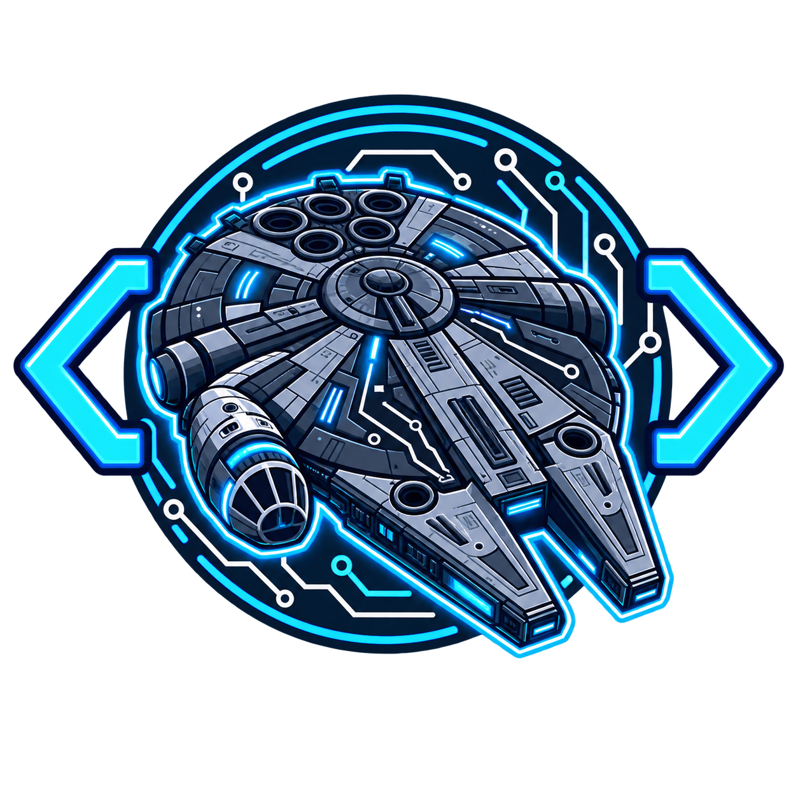
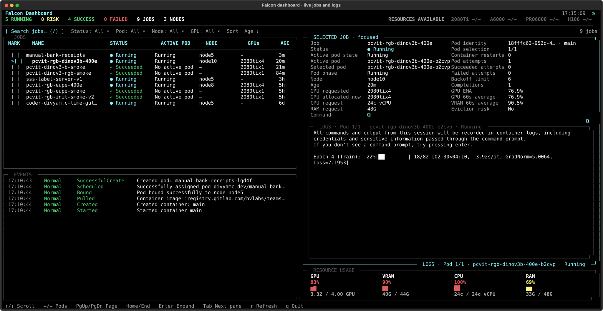
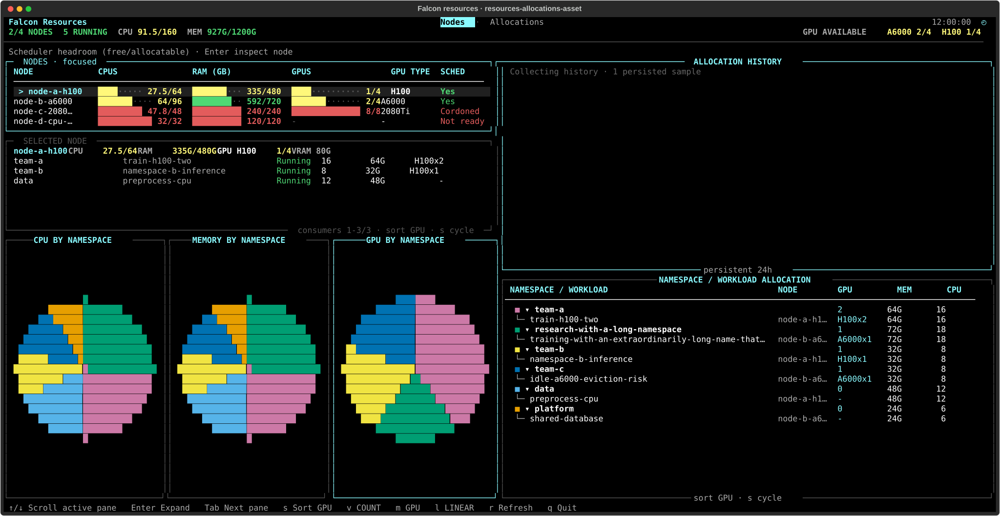

<h1>
  Falcon
  
</h1>

Launch and monitor GPU and CPU workloads on Kubernetes without writing Job YAML.

Falcon chooses eligible GPU nodes, sizes CPU and memory from live capacity,
carries your working directory and Python environment into the container, and
provides interactive dashboards for Jobs and cluster resources. Coding agents
can plan, launch, and manage Jobs through the built-in MCP server.

[Quick start](#quick-start) · [Dashboard](#dashboard) · [Resources](#resources) ·
[Coding agents](#coding-agents) · [Documentation](#documentation)

## Quick start

You need Python 3.10+, `kubectl`, a working Kubernetes context, and permission
to inspect cluster resources and create Jobs.

Install with pip:

```console
pip install --user git+https://github.com/DivyamChandalia/falcon.git@main
```

Or install as an isolated [uv](https://docs.astral.sh/uv/) tool:

```console
uv tool install git+https://github.com/DivyamChandalia/falcon.git@main
```

Run guided setup, launch a workload, then monitor or stop it:

```console
falcon setup
falcon h100x2 -j experiment -- python train.py
falcon dashboard
falcon logs experiment
falcon kill experiment
```

Setup configures your namespace, image, mounts, GPU presets, and scheduler. It
also offers MCP integration for coding agents. Rerun `falcon setup` whenever
you want to review or change these settings.

## Run workloads

Choose a GPU preset with an optional count, or request CPU and memory explicitly
for CPU-only work:

```console
falcon h100 -- python train.py
falcon pro6000x2 -j research -- python train.py
falcon -c 8 -m 32Gi -- python preprocess.py
```

Omit the command to open an interactive shell:

```console
falcon 2080ti
```

| Option | Purpose |
| --- | --- |
| `-j NAME` | Give the Job a stable name |
| `-f` | Follow logs after submitting |
| `-c VALUE` | Override CPU requests/limits |
| `-m VALUE` | Override memory requests/limits |
| `--image IMAGE` | Choose the runtime image |
| `--dry-run --output json` | Preview the manifest without creating a Job |

Bare memory values mean GiB (`-m 5` means `5Gi`). Request/limit pairs such as
`-m 5:8` are supported. Default GPU presets are `h100` (up to 8), `2080ti`
(up to 4), `a6000` (up to 2), and `pro6000` (up to 2); configure them through
setup for your cluster.

See the [CLI reference](docs/cli.md) for scheduling, Services, and all launch options.

## Dashboard

```console
falcon dashboard
```



Browse Jobs, Kubernetes events, live logs, and resource usage together. The layout
adapts to your terminal; expand a pane with `Enter` and restore it with `Esc`.

- **Logs:** follow output, scroll, drag-select and copy text, or search with
  `Ctrl+F`. Progress bars such as `tqdm` update in place.
- **Terminals:** press `Ctrl+T` with Selected Job focused to open a shell in its
  running Pod. Open multiple terminals, switch with `←`/`→`, and close one with
  `Ctrl+D`.
- **Restart history:** browse archived attempts with `←`/`→`. Agent-provided
  issue/fix summaries appear below the failed attempt's logs when available.
- **Agent monitoring:** an animated `◴◷◶◵` status symbol identifies Jobs with
  an active MCP event wait, preserving Pending and eviction-risk colors.

See [TUI controls](docs/tui.md) for navigation, log copying, terminal controls,
and restart-history storage.

For inspection from the command line:

| Command | Purpose |
| --- | --- |
| `falcon jobs` | List current Jobs |
| `falcon get JOB` | Inspect details and attempts |
| `falcon logs JOB` | Read or follow logs |
| `falcon events JOB` | Inspect Kubernetes events |
| `falcon metrics JOB` | Inspect CPU, RAM, GPU, and VRAM metrics |
| `falcon kill JOB` | Remove a Job |

Preview and remove multiple Jobs using quoted patterns:

```console
falcon kill 'benchmark-*' '*-ascformer-*' --dry-run
falcon kill 'benchmark-*' '*-ascformer-*'
```

Quote patterns so your shell does not expand them into local filenames. If any
pattern matches nothing, Falcon stops without deleting anything. See the
[CLI reference](docs/cli.md) for matching and deletion details.

## Resources

```console
falcon resources
```



Inspect node capacity and consumers alongside allocation history, namespace pies,
and the Namespace / Workload Allocation table. Terminals at least `160×30` show
Nodes on the left and Allocations on the right; smaller terminals use separate
pages. Individual panes can be selected and expanded.

Allocation values describe Kubernetes scheduler requests. Use Dashboard metrics
for measured workload utilization.

Press `m` to switch GPU, memory, and CPU charts; `v` switches GPU count and VRAM;
`l` toggles history's log scale. In the allocation table, use `s` to sort and `f`
to filter by resource requests or namespace.

See [TUI controls](docs/tui.md) for layouts and shortcuts, and
[resource semantics](docs/resource-semantics.md) for how values are calculated.

## Coding agents

Falcon includes an MCP server and managed skills for Codex, Claude Code, and
OpenCode. Run setup and accept the agent integration prompts:

```console
falcon setup
```

Agents can plan resource requests, submit Jobs, inspect logs and metrics, and
wait for meaningful events without repeatedly polling. Failed Jobs can be
restarted with archived logs and a short issue/fix summary for Dashboard review.
The MCP client starts the local server using your existing Kubernetes access and
configured namespace.

For automated setup:

```console
falcon setup --non-interactive --install-skills codex,claude,opencode --configure-mcp all
```

The previous CLI-based skill remains available through `--skill-mode legacy`.
See [coding-agent integration](docs/agents.md) for client configuration,
monitoring behavior, tool details, and legacy mode.

## Optional Coder workspaces

With access to a Coder deployment and compatible workspace template:

```console
falcon coder -c 4:4 -m 8Gi:8Gi
falcon coder pro6000 -j research
falcon coder research
```

Falcon creates or reconnects to the workspace and prints editor, JupyterLab, and
terminal links. See [Coder workspaces](docs/cli.md#coder-workspaces) for
authentication and workspace requirements.

## Configuration and maintenance

### Settings

Falcon stores configuration in `~/.falconrc`. Use guided setup to edit it or
inspect it with `falcon config`:

```console
falcon setup
falcon config
```

See [Configuration](docs/configuration.md) for mounts, environments, presets,
and other settings.

### Shell completion

Enable completion in your shell configuration:

```console
eval "$(falcon completion zsh)"  # use bash for Bash
```

Completion includes GPU presets, valid counts, Jobs, and Coder workspaces.

### Updates and removal

```console
falcon update --check
falcon update
```

Updates print a short What's New summary and refresh existing managed agent
skills, preserving MCP or legacy mode. See the [changelog](CHANGELOG.md) for full
release notes.

For uv installations, `falcon update` uses `uv tool upgrade` and preserves the
installed source, version constraints, and extras. uv must be on `PATH`. Other
installations update through pip in Falcon's Python environment.

To uninstall, use the command matching your installation:

```console
pip uninstall falcon-k8s
# Or, for uv tools:
uv tool uninstall falcon-k8s
```

## Troubleshooting

- **`falcon: command not found`:** open a new shell or add
  `$HOME/.local/bin` to `PATH`. For uv, run `uv tool update-shell` and reopen
  your terminal.
- **Kubernetes access errors:** check `kubectl config current-context` and
  permissions in your configured namespace.
- **Falcon cannot schedule from a Coder session:** rerun `falcon setup` and
  accept its offer to copy `kubectl` into `$HOME/.local/bin` (default Yes).
  The shared home makes the executable available in Coder; a valid kubeconfig
  and Kubernetes permissions are still required.
- **No matching GPU nodes:** check your configured GPU label, presets, and
  cluster capacity.
- **Coder authentication expired:** run `falcon coder WORKSPACE` to reopen
  sign-in.

## Documentation

- **Usage:** [CLI reference](docs/cli.md) · [TUI controls](docs/tui.md)
- **Setup:** [Configuration](docs/configuration.md) · [Coding agents](docs/agents.md)
- **Resources:** [Resource semantics](docs/resource-semantics.md) ·
  [Resource service](docs/resource-service.md)
- **Project:** [Development](docs/development.md) · [JSON schema](docs/json-schema.md) ·
  [Changelog](CHANGELOG.md)

## TODO

- [ ] **Falcon Sandbox:** `falcon sandbox` environments for Codex, Claude Code,
  and OpenCode to run agent goal loops, with an editable working directory and
  explicit read-only data mounts.
- [ ] **Shared vLLM:** discover and use shared model servers across users and
  agent Jobs.

Falcon is licensed under Apache-2.0. See [NOTICE](NOTICE) for attribution.
